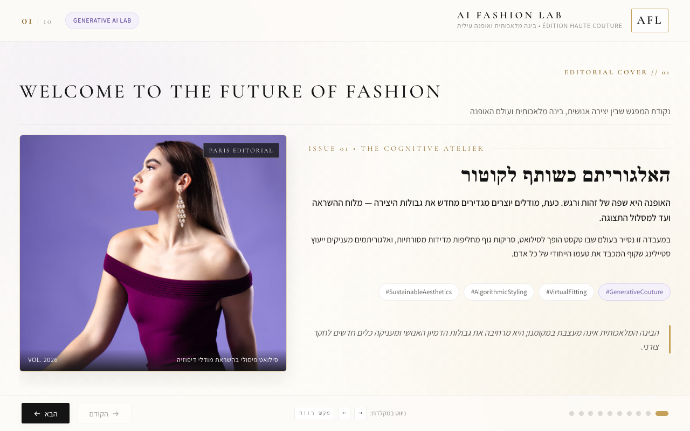
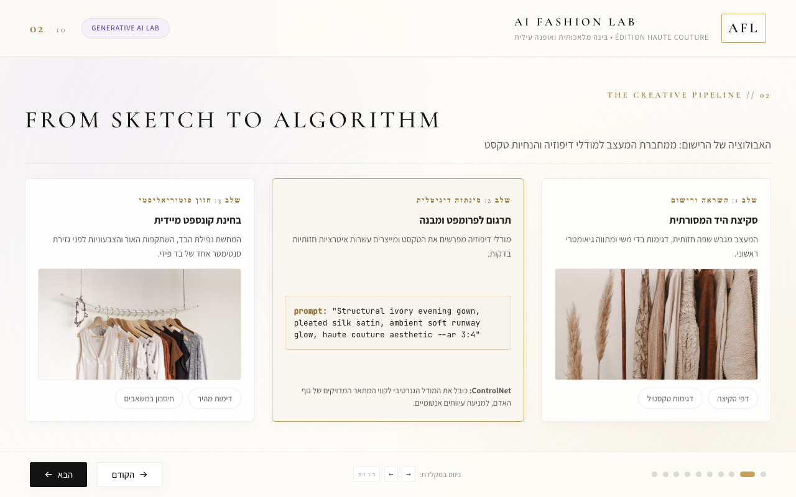
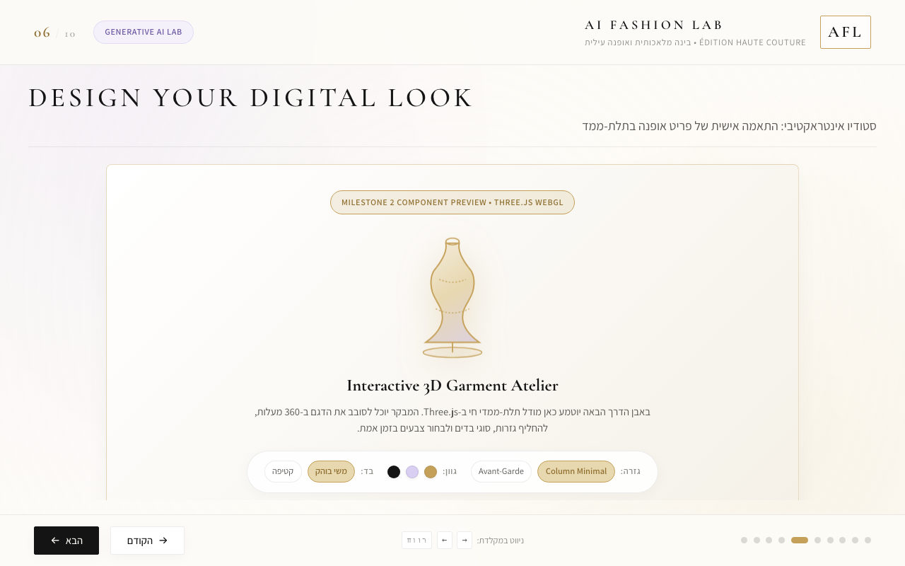
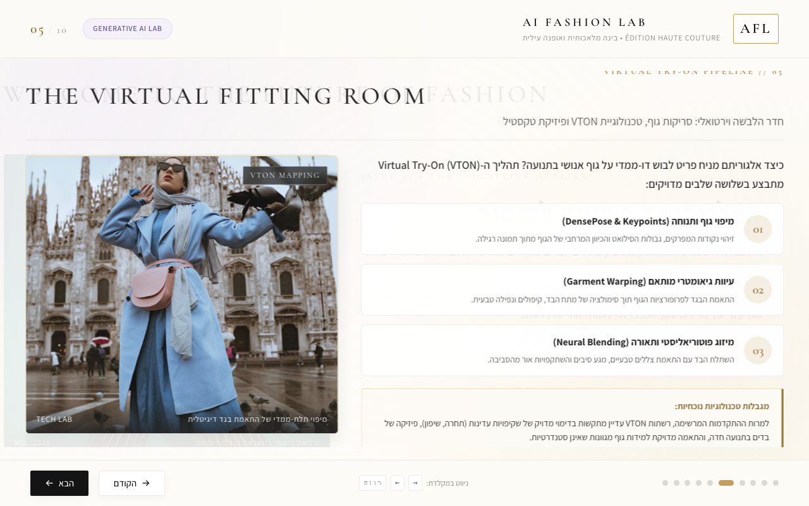

# AI FASHION LAB
### The Future of Fashion & Artificial Intelligence

**An Interactive Educational Presentation**

**Course:** Generative Artificial Intelligence  
**Lecturer:** Dr. Yoram Segal  
**Student:** Hadar Amar  
**Institution:** Bar-Ilan University

### [VIEW THE LIVE PRESENTATION](https://hadarAmar.github.io/AI-Fashion-Lab/)



---

## 1. Project Overview

**AI Fashion Lab** is an interactive HTML presentation exploring how artificial intelligence is influencing the fashion industry, from the creative design process to personalized styling, virtual fitting and sustainability.

The project was developed as part of a Generative Artificial Intelligence course.

Rather than creating a conventional presentation containing only text and images, I wanted to build an experience in which users could interact with the technology being discussed.

The presentation combines ten educational slides with JavaScript interactions, a Three.js digital garment studio and a Python recommendation algorithm.

The central question guiding the project is:

**How can artificial intelligence support creative processes in fashion while preserving human creativity and decision-making?**

The project examines this question both theoretically and through interactive demonstrations.

---

## 2. Project Goals

The main objectives of the project were:

- Explore practical applications of artificial intelligence in the fashion industry.
- Present complex technological concepts in an accessible and visually engaging format.
- Demonstrate how interactive 3D technology can support the design process.
- Use Python to perform a meaningful recommendation calculation.
- Create a coherent experience connecting different interactive elements.
- Explore the advantages, limitations and ethical challenges of AI in creative industries.
- Practice AI-assisted development through planning, testing, feedback and improvement.

The goal was not to build a commercial fashion application, but to demonstrate how digital tools can be used to explore and communicate ideas.

---

## 3. Presentation Structure

The project includes ten interactive and educational slides.

| Slide | Title | Main Content |
|---|---|---|
| 01 | Welcome to the Future of Fashion | Introduction to artificial intelligence in fashion |
| 02 | From Sketch to Algorithm | AI-assisted fashion design and image generation |
| 03 | Can AI Be a Fashion Designer? | Human creativity versus algorithmic design |
| 04 | Your Personal AI Stylist | AI-based personalization and recommendations |
| 05 | The Virtual Fitting Room | Virtual try-on technology and its limitations |
| 06 | Design Your Digital Look | Interactive 3D garment customization |
| 07 | The Smart Fashion Engine | Python-based recommendation algorithm |
| 08 | Can AI Make Fashion More Sustainable? | Sustainability and resource efficiency |
| 09 | The Human Behind the Algorithm | Ethics, responsibility and human judgment |
| 10 | Your Fashion Future | Personalized digital fashion passport |

### Visual and Educational Design

The presentation was designed in a luxury fashion editorial style, using:

- Ivory and warm neutral backgrounds.
- Champagne-gold and soft lilac accents.
- Elegant typography and fashion photography.
- Spacious layouts inspired by fashion magazines.
- English editorial titles with Hebrew educational explanations.

The visual approach was chosen to connect the presentation's subject matter with its appearance.



---

## 4. Interactive Features

### 4.1 JavaScript Navigation and Interactivity

JavaScript is used throughout the presentation to manage slide navigation and user interactions.

Users can move between slides, interact with interface controls and make selections that influence later parts of the experience.

The project was designed as a connected website rather than a collection of independent static images.

### 4.2 Interactive 3D Fashion Studio — Slide 6

One of the main features is an interactive garment customization studio built with **Three.js**.

The studio displays a three-dimensional garment that users can manipulate.

Users can change:

- Garment color.
- Fabric appearance.
- Silhouette and shape.

The object is rendered in real time, allowing users to observe changes directly.

This feature demonstrates the distinction between displaying a static image and interacting with a three-dimensional digital object.



### 4.3 Python Fashion Recommendation Engine — Slide 7

The second major technical feature is a fashion recommendation system implemented in Python.

The system receives user preferences, including:

- Personal style.
- Occasion.
- Budget.
- Selected garment color.
- Fabric.
- Silhouette.

It then evaluates a small, curated catalog of fashion looks and calculates compatibility scores.

The recommendation algorithm uses four weighted criteria:

| Criterion | Maximum Points |
|---|---:|
| Style compatibility | 35 |
| Occasion and silhouette | 30 |
| Color and fabric | 20 |
| Budget alignment | 15 |
| **Total** | **100** |

The rules are implemented in [`python/recommender.py`](python/recommender.py).

**Important distinction:** This is an educational, rule-based recommendation algorithm. It is not a trained AI model, and its compatibility scores are not scientifically validated measures of personal preference.

The Python implementation demonstrates how programming can be used to evaluate inputs, apply rules and generate personalized output.

### 4.4 Personalized Digital Fashion Passport — Slide 10

The final slide connects the earlier interactive components.

After customizing a garment and receiving a recommendation, users can view a personalized digital fashion passport.

The passport presents information from the user's selections and latest calculated recommendation, including the recommended look and compatibility score.

The purpose of this feature is to demonstrate how multiple interactive components can work together as part of one user experience.

---

## 5. Technologies Used

| Technology | Purpose |
|---|---|
| HTML5 | Structure of the presentation |
| CSS3 | Visual design, typography and responsive layout |
| JavaScript | Slide navigation, controls and interactive logic |
| Three.js | Interactive three-dimensional garment |
| Python | Recommendation algorithm and scoring |
| Pyodide | Attempted browser-based Python execution |
| Git | Version control |
| GitHub | Repository and project documentation |
| GitHub Pages | Public presentation hosting |
| AI Development Tools | Assistance with planning, code generation, debugging and refinement |

The project combines these technologies to create an interactive educational experience.

---

## 6. How to Run the Project

### Option A — View the Public Presentation

The easiest way to access the project is through GitHub Pages:

**https://hadarAmar.github.io/AI-Fashion-Lab/**

No software installation is required.

To experience the main interactive features:

1. Open the presentation.
2. Navigate to Slide 6 and customize the digital garment.
3. Continue to Slide 7, select your preferences and generate a recommendation.
4. Continue to Slide 10 to view the personalized fashion passport.

**Technical note:** GitHub Pages is a static hosting service. The public website attempts to initialize Pyodide for Python execution in the browser. If initialization fails, the recommendation feature uses a JavaScript implementation of the same scoring rules.

The JavaScript fallback is not equivalent to executing Python.

### Option B — Run the Project with Native Python

To demonstrate the actual Python recommendation engine, download or clone the repository and ensure Python 3 is installed.

Open a terminal in the project directory and run:

```bash
python3 server.py
```

Then open:

http://localhost:8000/

The local server runs the recommendation logic in Python.

### Run the Automated Tests

The repository also includes Python tests.

Run:

```bash
python3 -m unittest discover -s tests -v
```

These tests check selected recommendation scenarios and input handling. They do not replace manual testing of the website's visual layout and browser interactions.

---

## 7. Development Process and Working Method

The project was developed through an iterative process involving AI-assisted development, review, feedback and corrections.

The initial output was not treated as the final result. Different parts of the project were revised after identifying problems or opportunities for improvement.

### Stage 1 — Planning

The development began with a Product Requirements Document (PRD).

The document defined the concept, target audience, visual style, technical requirements and planned interactive features.

[View the original PRD](PRD.md)

### Stage 2 — Building the Initial Presentation

The next step was creating the HTML structure, CSS styling and JavaScript navigation.

The initial implementation established the ten-slide structure and the basic editorial visual language.

### Stage 3 — Visual Review and Improvements

During development, the presentation was reviewed and revised.

The main improvements included:

- Reducing unnecessarily dense text.
- Improving visual hierarchy and spacing.
- Refining the fashion editorial style.
- Revising selected images.
- Adjusting layouts for different screen sizes.

These changes were intended to improve readability and strengthen the relationship between content and design.

### Stage 4 — Developing the 3D Component

An interactive garment studio was introduced using Three.js.

Instead of presenting a static representation, the garment could be customized through user selections.

This added a practical interactive element to the presentation.

### Stage 5 — Implementing the Python Algorithm

The recommendation engine was developed to provide a meaningful use of Python within the project.

During integration, browser-based Python initialization caused technical problems.

A local Python server was used to provide a functioning native Python execution path.

For the publicly hosted version, a JavaScript fallback was added so the recommendation interface could remain usable if Pyodide failed.

This was an architectural compromise, and the two execution methods are documented separately.

### Stage 6 — Connecting the Interactive Slides

Another development challenge involved transferring the recommendation result to the final slide.

The presentation was revised so that Slide 10 could use the latest calculated recommendation rather than displaying a fixed example.

This helped turn separate demonstrations into a more coherent user experience.

### Stage 7 — GitHub Publication and Documentation

The project was published through GitHub Pages and documented in the repository.

The development history, requirements and prompt-related documentation were retained to show how the project evolved.

---

## 8. My Decisions and Critical Evaluation

The assignment required more than generating a website using AI tools. It required reviewing the output and making decisions about what should be changed.

Several decisions were especially important:

**Choosing an interactive presentation instead of a conventional slide deck**

An interactive format made it possible to demonstrate digital design and personalization through direct user participation.

**Developing a consistent visual identity**

The editorial style was selected to strengthen the connection between fashion and technology.

**Adding user-controlled 3D customization**

The 3D element became an active demonstration rather than a purely decorative animation.

**Connecting the recommendation engine to the final slide**

The personalized passport was introduced to make the interactive features work together.

**Addressing technical failures instead of ignoring them**

The Python initialization problems required investigating different execution methods and acknowledging the limitations of static hosting.

These decisions illustrate the importance of evaluating AI-generated code and making deliberate changes throughout development.

---

## 9. GitHub History and Prompt Documentation

The repository includes supporting files documenting the project's development.

### Project Requirements Document

The original planning document describes the initial project goals and proposed architecture.

**[View PRD.md](PRD.md)**

### Prompt Engineering and Development Log

A separate document summarizes the development process, prompts, technical challenges, corrections and decisions.

**[View Development and Prompt Log](prompts/development-log.md)**

The log includes reconstructed descriptions of some earlier prompts because the complete original agent transcript is not available. These reconstructed entries are identified as such and should not be interpreted as verbatim conversation records.

### Git Development History

The original local Git history was preserved in a separate branch.

**[View Original Development Commits](https://github.com/hadarAmar/AI-Fashion-Lab/commits/development-history)**

The main branch contains the publicly uploaded project and subsequent changes.

**[View Main Branch History](https://github.com/hadarAmar/AI-Fashion-Lab/commits/main)**

The original local commits were uploaded to the separate development-history branch after the public repository had been established.

These records provide evidence of different development stages without presenting them as a sequence of earlier GitHub pushes.

---

## 10. Screenshots and Visual Documentation

The repository includes screenshots from desktop and mobile development stages.

### Editorial Opening


### Interactive 3D Design


### Virtual Fitting Technology



### Mobile Interface

[View Mobile Presentation Screenshot](screenshots/mobile-slide1-new.png)

[View Mobile 3D Studio Screenshot](screenshots/mobile-slide6.png)

Some screenshots reflect earlier development versions. The published website should be used to inspect current interactive behavior.

---

## 11. Limitations and Future Improvements

The project demonstrates several technologies, but it also has important limitations.

- The 3D garment is a procedural visualization, not a physically accurate clothing simulation.
- The virtual fitting content is illustrative and does not perform real body measurements.
- The recommendation algorithm uses predefined rules rather than a trained machine-learning model.
- The recommendation catalog is limited and does not contain live product information.
- Browser-based Python execution may fail, requiring the documented JavaScript fallback.
- Further browser, mobile and accessibility testing would improve reliability.
- Externally sourced fashion images and educational claims require careful attribution and verification before broader reuse.

Possible future improvements include a larger recommendation catalog, more advanced garment visualization, more reliable Python execution in the browser and usability testing with real users.

---

## 12. Final Reflection

Developing AI Fashion Lab demonstrated that using artificial intelligence in a creative project involves more than generating content or code.

The process required planning, evaluating results, identifying problems and making changes.

The most valuable part of the experience was learning to treat AI-generated output as a starting point that still requires human judgment.

The project also highlights the relationship between creativity and technology: digital tools can expand what is possible, but they do not remove the need for thoughtful design decisions.

**The main conclusion is that AI can support and accelerate creative work, while responsibility for the final result remains with the person directing the process.**

---

## Project Links

| Resource | Link |
|---|---|
| Live Presentation | [AI Fashion Lab](https://hadarAmar.github.io/AI-Fashion-Lab/) |
| GitHub Repository | [Project Repository](https://github.com/hadarAmar/AI-Fashion-Lab) |
| Product Requirements Document | [PRD.md](PRD.md) |
| Development and Prompt Log | [Development Log](prompts/development-log.md) |
| Python Recommendation Engine | [recommender.py](python/recommender.py) |
| Python Tests | [test_recommender.py](tests/test_recommender.py) |
| Original Git Development History | [Development History](https://github.com/hadarAmar/AI-Fashion-Lab/commits/development-history) |
