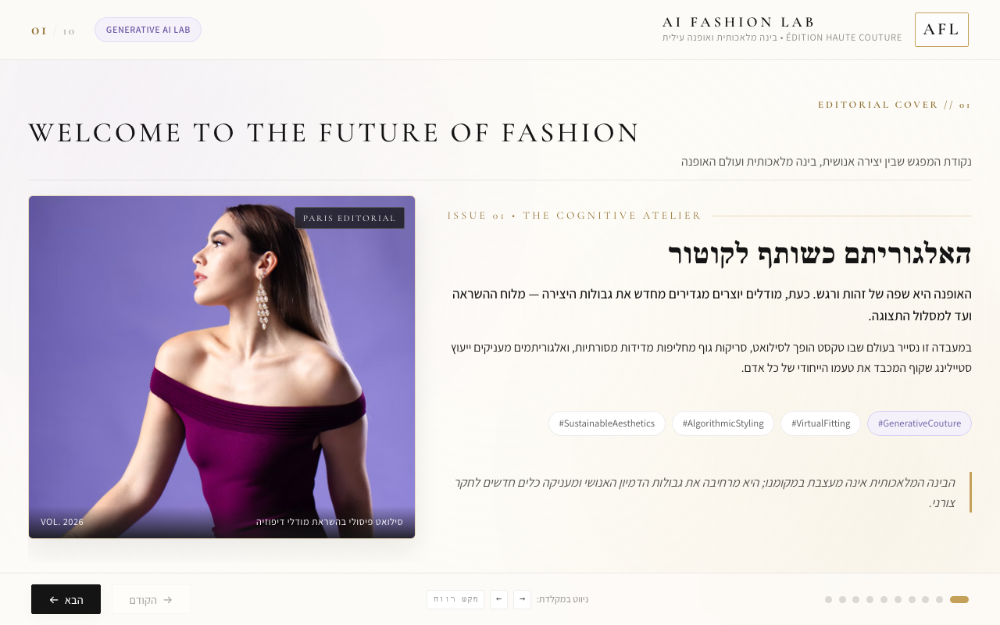
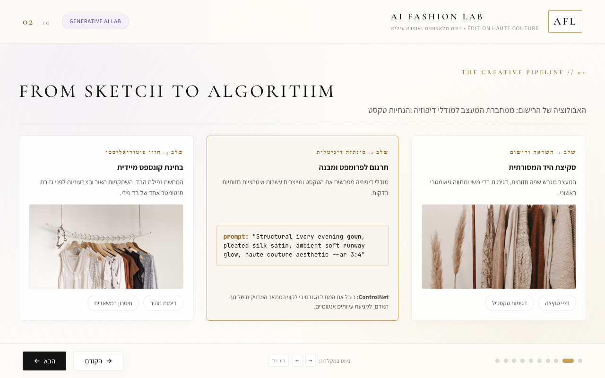
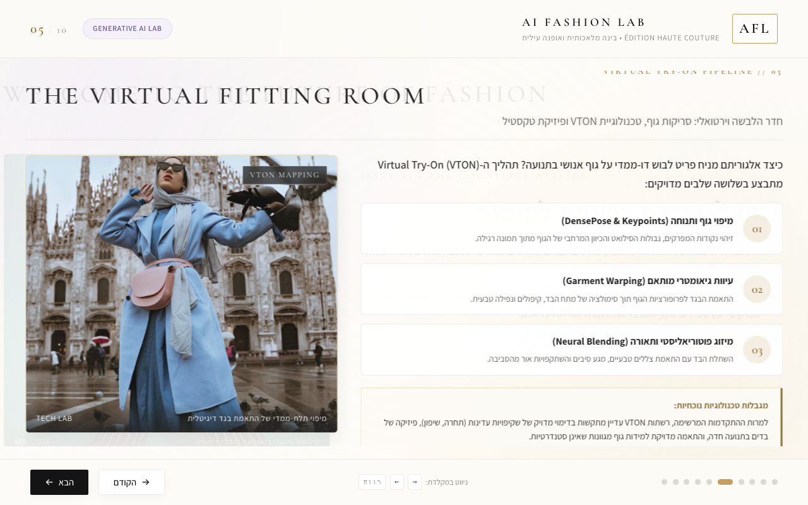
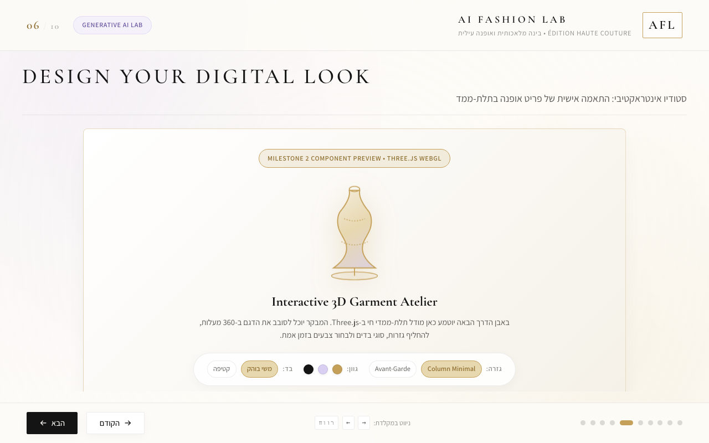

# AI Fashion Lab — Prompt History & Development Evidence

**Course:** Generative Artificial Intelligence · **Lecturer:** Dr. Yoram Segal  
**Submitted by:** **Hadar Amar & Efrat Reznik**  
**Submission:** Pair assignment  
**[Public presentation](https://hadarAmar.github.io/AI-Fashion-Lab/)** · **[Repository](https://github.com/hadarAmar/AI-Fashion-Lab)**

## 1. Purpose and evidence standard

This document records the available evidence of AI-assisted planning, development, feedback and corrections for **AI Fashion Lab**, an interactive ten-slide educational presentation about AI in fashion.

The lecturer asks for evidence that students **requested, reviewed, corrected and improved** AI-generated results. The development record is therefore arranged as **requirement → observed result → problem/criticism → correction → evidence**.

**Important academic disclosure:** The full original Antigravity/CLI conversation is not available. This file is **not a complete verbatim transcript**. The few recovered student phrases below are preserved from the prior ChatGPT development record; longer requests are described as *paraphrases* rather than invented direct quotations. Code and Git history demonstrate changes made, not the precise wording of every prompt. No missing agent response is fabricated.

**Pair attribution:** The final project is submitted by **Hadar Amar and Efrat Reznik**. Available messages and commits do not verify a complete individual contribution breakdown. The documented requests and decisions are kept in their source context; the record does not claim that both students personally performed every step.

## 2. Project outline

**Goal:** Make an interactive fashion editorial experience combining AI concepts with three concrete technical demonstrations:

1. **JavaScript** navigation and user interaction throughout ten HTML slides.
2. **Three.js** procedural, animated 3D garment customization (Slide 6).
3. **Python** fashion recommendation logic (Slide 7), with a personalized result on Slide 10.

**Creative direction:** Bright, clean, luxury fashion-magazine styling with Hebrew explanatory content and English slide headings.

**Core technical distinction:** The Python recommendation engine is a **deterministic rule-based simulation**, not a trained generative model; the public GitHub Pages version may use a JavaScript fallback if the Pyodide runtime fails.

## 3. Evidence summary

| Evidence | What it supports | Limitation |
|---|---|---|
| [Original PRD commit](https://github.com/hadarAmar/AI-Fashion-Lab/commit/ebdac94) | Initial planning preceded implementation | No full original conversation transcript |
| [First HTML commit](https://github.com/hadarAmar/AI-Fashion-Lab/commit/b466279) | Initial implementation stage | Commit message is not an AI prompt |
| [Visual revision commit](https://github.com/hadarAmar/AI-Fashion-Lab/commit/2dbe336) | Layout and imagery refinement | May not capture all intermediate iterations |
| [Three.js commit](https://github.com/hadarAmar/AI-Fashion-Lab/commit/8fd810a) | Interactive garment feature | Does not assign an individual contributor |
| [Python source](../python/recommender.py) and [tests](../tests/test_recommender.py) | Real Python scoring implementation | Tests do not prove public Pyodide execution |
| [Runtime manager](../js/python-engine.js) and [server](../server.py) | Runtime adaptations | Local Python and public JavaScript are different execution modes |
| [Passport controller](../js/passport.js) | Shared result and Slide 10 behavior | Does not show a full original bug-report thread |
| [Screenshots](../screenshots/) | Selected visual states | Some are from earlier versions |

## 4. Iteration A — Define the visual concept

**Date:** November 3, 2026 (development conversation)

**Student preference preserved in the earlier development record (Hebrew):**

> יוקרתי, בהיר ונקי בסגנון מגזין אופנה

*Translation: Luxurious, bright and clean, in the style of a fashion magazine.*

**Requirement:** Create a distinctive, fashion-specific visual identity instead of a generic presentation theme.

**Observed result:** Ivory and champagne palette, lilac accents, large editorial English headings, Hebrew explanations and fashion imagery.

**Evaluation and revision:** The first layout required changes to text density and visual storytelling. The revised interface used more varied layouts and stronger imagery.

**Evidence:** [Visual refinement commit](https://github.com/hadarAmar/AI-Fashion-Lab/commit/2dbe336)

**What this demonstrates:** A specific creative direction guided the output, and the first result was revised.

## 5. Iteration B — Plan first, then implement

**Date:** November 3, 2026

**Requirement summary — not verbatim:** Plan approximately ten educational slides about AI and fashion, with JavaScript interaction, Hebrew/English layout, animated 3D functionality and a meaningful Python component. Produce the PRD before implementing the first presentation.

**Observed sequence in Git:**

| Time (UTC) | Commit | Outcome |
|---|---|---|
| 10:53:30 | [`ebdac94`](https://github.com/hadarAmar/AI-Fashion-Lab/commit/ebdac94) | PRD created |
| 11:02:29 | [`b466279`](https://github.com/hadarAmar/AI-Fashion-Lab/commit/b466279) | Initial HTML presentation |
| 11:47:09 | [`2dbe336`](https://github.com/hadarAmar/AI-Fashion-Lab/commit/2dbe336) | Visual storytelling revised |

**Critical observation:** The first implementation established navigation and design structure, but the presentation needed further editorial refinement.

**Correction:** Improved imagery, hierarchy and visual variety.

**Limitation:** The full original request and the AI's exact response are not preserved. These are source-backed development stages rather than quoted prompts.

## 6. Iteration C — Improve Slide 5 and build the 3D garment

**Date:** November 3, 2026

**Documented instruction — paraphrase, not verbatim:** Improve the visual depiction of virtual fitting on Slide 5; create a Three.js garment studio on Slide 6 with selectable colors, fabric finishes and silhouettes. Defer the Python work until this stage is complete.

**Observed result:**

- Slide 5 received an illustrative virtual-fitting presentation.
- Slide 6 gained a procedural Three.js 3D garment and visible user controls.
- A dedicated 3D milestone was committed at 12:03:08 UTC.

**Evidence:** [Three.js milestone](https://github.com/hadarAmar/AI-Fashion-Lab/commit/8fd810a) · [Implementation](../js/three-studio.js)

**Evaluation:** Interaction made the fashion technology more concrete than a static image. The model is not a physically validated fabric or body-fitting system.

## 7. Iteration D — Implement and debug Python

**Date:** November 3, 2026

**Requirement summary — not verbatim:** Make Slide 7 calculate a genuine recommendation using Python rather than show a fixed or decorative code example. Use style, occasion, budget, color, fabric and silhouette to rank looks and explain the score.

**Failure message preserved in the previous project record (Hebrew):**

> לא ניתן להפעיל Python. בדקי חיבור לאינטרנט ונסי שוב.

*Translation: Python could not be started. Check the internet connection and try again.*

**Problem:** The planned browser-based Python environment (Pyodide) did not initialize reliably during development.

**Correction:** Add `server.py` to run the actual scoring logic in Python locally. Maintain a browser Pyodide attempt and a **labeled JavaScript fallback** for public static hosting.

**Technical output:** The Python model applies a four-part scoring matrix: style **35**, occasion/silhouette **30**, color/fabric **20** and budget **15** points (total **100**).

**Evidence:** [Python engine](../python/recommender.py) · [Server](../server.py) · [Tests](../tests/test_recommender.py) · [Public fallback](../js/static-recommender.js).

**Reported outcome:** The local Python path was confirmed working in the preceding development interaction. The public website may use JavaScript; a working online score alone does not establish Python execution.

**Lesson:** Generated code has to be tested in its target runtime, not just read or visually presented.

## 8. Iteration E — Synchronize Slides 7 and 10

**Date:** November 3, 2026

**Student feedback preserved in the earlier development record (Hebrew):**

> שקופית 10 לא מתעדכנת משקופית 7

*Translation: Slide 10 does not update from Slide 7.*

**Problem:** The final fashion passport did not reflect the latest recommendation.

**Correction:** Preserve the latest successful recommendation in application state and update the passport from that result instead of a fixed example.

**Evidence:** [Recommendation controller](../js/python-engine.js) · [Passport integration](../js/passport.js).

**Reported outcome:** Subsequent testing confirmed the synchronization correction.

**Lesson:** A working component does not prove a working end-to-end journey; state must be checked across slides.

## 9. Iteration F — Publish without misrepresenting the runtime

**Period:** November 3–8, 2026

**Requirement summary — not verbatim:** Make the presentation available through a free public link without installing a local server on every visitor's machine.

**Problem:** GitHub Pages cannot run the native Python server.

**Solution:** Publish the presentation on [GitHub Pages](https://hadarAmar.github.io/AI-Fashion-Lab/), attempt browser Python with Pyodide, and provide a JavaScript fallback if that initialization fails. Keep the native Python path for local demonstration.

**Critical qualification:** JavaScript fallback is not Python; the two execution paths are described separately in the [README](../README.md) and [PRD](../PRD.md).

**Evidence:** [Static recommender](../js/static-recommender.js) · [Published repository commits](https://github.com/hadarAmar/AI-Fashion-Lab/commits/main).

## 10. Git history — original local milestones

All timestamps below are from **November 3, 2026 (UTC)**.

| Time | Commit | Original commit subject |
|---|---|---|
| 10:53:30 | [`ebdac94`](https://github.com/hadarAmar/AI-Fashion-Lab/commit/ebdac94) | docs: create comprehensive PRD for AI Fashion Lab presentation |
| 11:02:29 | [`b466279`](https://github.com/hadarAmar/AI-Fashion-Lab/commit/b466279) | feat: implement Milestone 1 initial HTML presentation with editorial styling and navigation |
| 11:47:09 | [`2dbe336`](https://github.com/hadarAmar/AI-Fashion-Lab/commit/2dbe336) | feat: enhance visual storytelling, diverse magazine layouts, editorial imagery, and content accuracy |
| 12:03:08 | [`8fd810a`](https://github.com/hadarAmar/AI-Fashion-Lab/commit/8fd810a) | feat: implement Milestone 2 interactive Three.js 3D garment studio and virtual fitting HUD |
| 13:16:46 | [`018a4c9`](https://github.com/hadarAmar/AI-Fashion-Lab/commit/018a4c9) | Prepare AI Fashion Lab for public deployment |

The commits were created locally, then later uploaded to the [`development-history` branch](https://github.com/hadarAmar/AI-Fashion-Lab/commits/development-history). This demonstrates local version progression, but **does not prove five independent GitHub pushes on November 3**. The [`main` branch](https://github.com/hadarAmar/AI-Fashion-Lab/commits/main) contains public uploads and later changes.

## 11. Critical evaluation

| Review point | Initial issue or decision | Change made | Evidence |
|---|---|---|---|
| Editorial style | Generic layouts were not appropriate | Bright luxury magazine style and refinements | [Visual commit](https://github.com/hadarAmar/AI-Fashion-Lab/commit/2dbe336) |
| Visual fitting | Needed a clearer explanation | Illustrative virtual fitting slide | [Slide 5 screenshot](../screenshots/desktop-slide5.png) |
| Three-dimensional experience | Static imagery was insufficient | Three.js customization | [Slide 6 screenshot](../screenshots/desktop-slide6.png) |
| Python runtime | Browser Python failed to initialize | Native server route | [server.py](../server.py) |
| Result consistency | Slide 10 did not update | Passport connected to latest successful result | [passport.js](../js/passport.js) |
| Public delivery | Static hosting could not run native Python | Documented browser/runtime fallback | [static-recommender.js](../js/static-recommender.js) |

**Reflection:** AI-assisted tools helped accelerate the implementation, but the project required clear direction, review of visuals, troubleshooting and awareness of limitations. The meaningful learning process was not simply receiving generated code; it was identifying what did and did not work and improving the result.

## 12. Evidence gaps and academic honesty

The following items are **not claimed** in this document:

- A complete, verbatim Antigravity prompt-and-response export.
- Full original agent responses for each iteration.
- Independently confirmed individual contributions for both submitting students.
- A complete before/after screenshot archive of every revision.
- Real-time native Python running on GitHub Pages.

This partial evidence record uses retained Git commits, source files, screenshots and selected feedback excerpts. It should be supplemented with original chat exports if they become available and the lecturer requires them.

## 13. References to project artifacts

- [Interactive presentation](https://hadarAmar.github.io/AI-Fashion-Lab/)
- [Repository README](../README.md)
- [PRD](../PRD.md)
- [Early development history](https://github.com/hadarAmar/AI-Fashion-Lab/commits/development-history)
- [Python engine](../python/recommender.py)
- [Three.js studio](../js/three-studio.js)
- [Screenshot archive](../screenshots/)

---

**Submission:** Hadar Amar & Efrat Reznik · **Record type:** Source-grounded development evidence, not a complete verbatim agent transcript.
