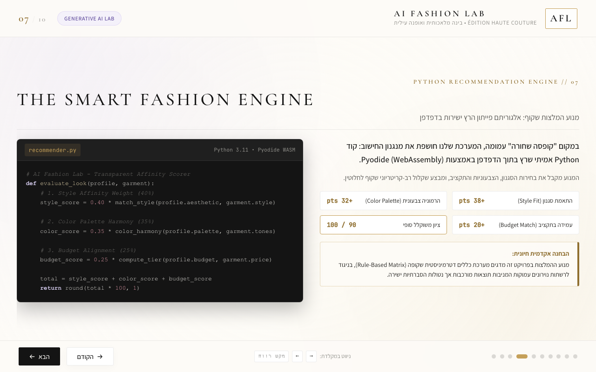

# AI Fashion Lab
## Prompt Engineering, Development Process & Critical Reflection

**Project:** AI Fashion Lab – The Future of Fashion and Artificial Intelligence  
**Course:** Generative Artificial Intelligence  
**Project Type:** Interactive Web Presentation  
**Technologies:** ChatGPT, Antigravity CLI, HTML, CSS, JavaScript, Three.js, Python, Git, GitHub Pages

**Live Presentation:** https://hadarAmar.github.io/AI-Fashion-Lab/

**GitHub Repository:** https://github.com/hadarAmar/AI-Fashion-Lab

---

# 1. Project Introduction

Our objective was to develop an interactive educational experience exploring the relationship between artificial intelligence and the fashion industry.

Instead of creating a conventional presentation, we wanted to demonstrate how technology can become part of the learning experience.

The project combines ten educational slides with interactive features, including a 3D garment customization studio, a recommendation algorithm implemented in Python, and a personalized fashion passport.

Throughout development, we used AI-assisted coding tools while reviewing the results, identifying problems, suggesting improvements, and testing functionality.

## Documentation Method

This document is based on the available ChatGPT conversations, project files, and development results.

The original Antigravity conversation history is no longer accessible. Therefore, several prompts are reconstructed from documented requirements and decisions.

**Reconstructed prompts are examples of the instructions used during development, not verified verbatim transcripts.**

The document also includes authentic user feedback from the development conversation.

---

# 2. Stage One — Concept Development and Planning

### Objective

Establish a clear project concept, define technical requirements, and plan the presentation before implementation.

### Reconstructed Prompt 01

> Create a Product Requirements Document (PRD) for an interactive educational presentation titled "AI Fashion Lab – The Future of Fashion and Artificial Intelligence".
>
> The presentation should contain approximately ten slides exploring how AI is transforming the fashion industry.
>
> Educational explanations should be written in Hebrew, while slide headings should be in English.
>
> Include interactive JavaScript functionality, a Three.js 3D fashion experience, and a meaningful Python component.
>
> Begin with a structured PRD before implementing the presentation.

### Result

A `PRD.md` document was created to define the project goals, target audience, visual identity, technical architecture, and slide structure.

### Our Decision

We decided that the project should demonstrate technology through interaction rather than simply describing technological concepts.

This decision influenced the creation of the 3D garment studio and the personalized recommendation experience.

---

# 3. Stage Two — Building the Initial Presentation

### Objective

Develop a functional presentation with ten slides, navigation, and a consistent visual identity.

### Reconstructed Prompt 02

> Using the project PRD, develop an interactive HTML presentation with ten slides.
>
> Use CSS for visual styling and JavaScript for navigation and interactions.
>
> Ensure that Hebrew content displays correctly from right to left.
>
> Create a luxury fashion editorial design using ivory backgrounds, champagne-gold accents, soft lilac details, and elegant typography.
>
> Prepare dedicated interactive areas for the 3D garment studio and Python recommendation engine.
>
> Organize the project files clearly and use Git commits to track development.

### Result

The first functional presentation included a ten-slide structure, navigation controls, and the initial visual design.

### Evaluation

Although the presentation worked, the initial design required improvements.

Some slides contained too much text, and the layouts did not yet communicate the sophisticated fashion experience we wanted.

---

# 4. Stage Three — Improving the Visual Design

### Objective

Transform the presentation into a more visually engaging experience.

### Reconstructed Prompt 03

> Refine the presentation to resemble a professional luxury fashion editorial publication.
>
> Reduce unnecessary text and improve visual hierarchy.
>
> Incorporate relevant fashion imagery and create varied slide layouts.
>
> Improve typography, spacing, responsive behavior, and the balance between images and educational content.
>
> Preserve the overall color palette while giving each slide its own visual identity.

### Result

The presentation was refined with fashion imagery, clearer content organization, and more distinctive visual compositions.

### Critical Reflection

We learned that good visual design is not only about aesthetics. It also affects how users understand information.

We prioritized a balance between educational content and visual communication.

### Visual Evidence

*Figure 1: The presentation's editorial visual identity.*

*Figure 2: Content organization and visual storytelling.*

---

# 5. Stage Four — Virtual Fitting and Interactive 3D Design

### Objective

Create a practical demonstration of technology in fashion design.

### Documented Requirements — Summary

During development, we requested improvements to Slide 5 and the implementation of an interactive Three.js experience in Slide 6.

The main requirements were:

- Replace the virtual fitting room image with a more relevant fashion-technology visual.
- Build an interactive 3D garment using Three.js.
- Allow users to change garment colors.
- Allow users to experiment with fabric finishes.
- Support different silhouettes.
- Preserve the presentation's visual identity.

These requirements summarize the documented development discussions rather than reproduce a complete original Antigravity prompt.

### Reconstructed Prompt 04

> Improve Slide 5 by using a more suitable visualization of virtual fitting technology.
>
> In Slide 6, create a functional interactive fashion design studio using Three.js.
>
> The user should be able to customize the garment's color, fabric, and silhouette.
>
> Changes should be reflected visually in the 3D model.
>
> Maintain the existing editorial styling and ensure the interface remains responsive.

### Result

A functional Three.js fashion studio was developed.

Users can interact with a virtual garment and customize visual properties.

### Critical Reflection

This feature made the project more engaging and demonstrated the potential of interactive digital fashion tools.

However, the 3D garment is a visual simulation rather than a physically accurate virtual fitting system.

### Visual Evidence

*Figure 3: Virtual fitting technology illustration.*

*Figure 4: Interactive 3D garment customization.*

---

# 6. Stage Five — Developing the Python Recommendation Engine

### Objective

Implement meaningful Python functionality rather than using Python only as a decorative code example.

### Reconstructed Prompt 05

> Create a real Python recommendation engine for Slide 7.
>
> The algorithm should evaluate fashion style, occasion, budget, garment color, fabric, and silhouette.
>
> Use transparent weighted scoring rules to calculate compatibility.
>
> Return a recommended fashion look, a compatibility score, and an explanation of the result.
>
> Connect the recommendation to the user's interactive selections from the 3D garment studio.

### Implementation

The recommendation algorithm was implemented in:

`python/recommender.py`

The scoring system uses four criteria:

| Criterion | Maximum Points |
|---|---:|
| Personal style compatibility | 35 |
| Occasion and silhouette | 30 |
| Color and fabric compatibility | 20 |
| Budget alignment | 15 |
| **Total** | **100** |

The result is based on deterministic rules rather than machine learning.

### Technical Challenge

Our initial approach attempted to execute Python directly inside the browser using Pyodide.

However, the Python runtime failed to initialize correctly in the tested environment.

### Solution

We developed a local Python server using:

`server.py`

The browser communicates with this server, which executes the Python recommendation algorithm and returns the result.

### Evaluation

We verified that the local Python server could calculate recommendations and return results to Slide 7.

### Visual Evidence

*Figure 5: The recommendation interface.*

---

# 7. Stage Six — Connecting Slides 7 and 10

### Objective

Create a continuous experience connecting the user's garment design, recommendations, and personalized results.

### Reconstructed Prompt 06

> Connect the recommendation generated in Slide 7 to the personalized fashion passport on Slide 10.
>
> Replace the original static score with the actual calculated score.
>
> Display the user's recommended fashion look and garment selections.
>
> Ensure that the final slide updates whenever a new recommendation is calculated.

### Problem Identified During Testing

An authentic user report from our ChatGPT development conversation was:

> שקופית 10 לא מתעדכנת משקופית 7

Translation:

"Slide 10 is not updating based on Slide 7."

### Improvement

We revised the way the recommendation result was stored and transferred between slides.

The application was updated to preserve the latest calculated result and make it available to the final fashion passport.

### Outcome

After the correction, the user confirmed that the synchronization worked.

### Learning

Testing features separately is not enough.

Even when the Python recommendation engine and the final presentation slide work individually, the connection between them must be tested.

---

# 8. Stage Seven — Publishing the Project

### Objective

Publish the presentation through a public URL so it can be accessed without downloading the project files.

### Reconstructed Prompt 07

> Prepare the presentation for public deployment.
>
> Preserve the interactive features, navigation, 3D functionality, and recommendation system.
>
> Ensure that users can access the presentation through a public URL.
>
> Explain and handle differences between local Python execution and static web hosting.

### Challenge

The local presentation worked using the Python server, but opening `index.html` directly did not provide the same functionality.

Additionally, GitHub Pages hosts static websites and cannot execute the local Python server.

### Solution

We published the presentation using GitHub Pages.

The public version attempts to load Python through Pyodide. If this fails, it uses a JavaScript implementation of the recommendation logic.

### Important Technical Limitation

The JavaScript fallback is not Python execution.

Therefore, the project currently has two execution modes:

**Local version:** Runs the recommendation algorithm using actual Python through `server.py`.

**Public GitHub Pages version:** Attempts Pyodide and uses JavaScript as a fallback if Python initialization fails.

The project does not claim that JavaScript execution is equivalent to running Python.

### Result

The presentation became accessible through:

https://hadarAmar.github.io/AI-Fashion-Lab/

---

# 9. Iterative Development and Debugging

One of the most important aspects of this project was the repeated process of evaluating results and improving them.

| Development Stage | Problem or Feedback | Action Taken |
|---|---|---|
| Initial presentation | Text-heavy and repetitive layouts | Improved visual hierarchy and imagery |
| Virtual fitting room | Visual required improvement | Revised Slide 5 imagery |
| 3D studio | Needed meaningful interaction | Added customization controls |
| Python recommendation | Pyodide initialization failed | Implemented a local Python server |
| Personalized results | Slide 10 did not update | Improved recommendation synchronization |
| Public deployment | Static hosting could not execute the Python server | Added a documented JavaScript fallback |
| GitHub integration | Public version initially produced a runtime error | Corrected the missing fallback file |

These iterations show how feedback and testing affected the final product.

---

# 10. Critical Reflection

### What Worked Well?

The combination of educational content and interactive features made the project more engaging than a conventional presentation.

Three.js enabled users to experiment with garment customization, while the recommendation engine demonstrated transparent algorithmic decision-making.

The visual identity remained consistent throughout the project.

### What Did Not Work Initially?

The first version required visual refinement.

The initial browser-based Python runtime was unreliable.

Slide 10 initially failed to reflect the recommendation calculated in Slide 7.

Publishing the project also introduced additional challenges because local execution and static web hosting have different technical requirements.

### What Would We Improve?

With additional development time, we would prioritize:

1. Reliable browser-based Python execution without requiring a JavaScript fallback.
2. More advanced 3D garment modeling and physically realistic fabric simulation.
3. Additional usability testing on mobile devices.
4. More personalized recommendation criteria and a larger fashion catalog.
5. Automated end-to-end testing for the full interactive experience.

### What Did We Learn About AI-Assisted Development?

We learned that AI can accelerate planning, coding, and debugging, but generated outputs still require human evaluation.

Our role was not limited to requesting code.

We had to evaluate design quality, identify technical issues, refine requirements, test functionality, and decide which solutions best supported the educational objective.

The project demonstrates an iterative collaboration between human decision-making and AI-assisted development.

---

# 11. Evidence, Repository, and Documentation Limitations

The GitHub repository includes supporting evidence such as:

- `PRD.md` — project planning and requirements.
- `index.html` — the interactive presentation.
- `js/three-studio.js` — the 3D garment visualization.
- `python/recommender.py` — the native Python recommendation engine.
- `server.py` — the local Python server.
- `js/passport.js` — personalized results integration.
- `screenshots/` — visual evidence of selected presentation stages.
- Git commits — version history currently available in the public repository.

### Documentation Limitations

The original Antigravity conversations are no longer accessible.

The prompts labeled "Reconstructed Prompt" in this document are based on available project requirements and development discussions.

They are not presented as exact copies of the instructions originally entered into Antigravity.

Some development milestones were committed locally, but the public GitHub repository was subsequently populated through browser uploads. Therefore, its public commit history does not fully represent every original local development step.

The screenshots document selected interface states but do not constitute complete evidence of every AI conversation.

This distinction is important for the accuracy and academic integrity of the project.

---

# 12. Final Conclusion

AI Fashion Lab demonstrates how artificial intelligence concepts can be explored through an interactive educational experience.

The project combines visual design, 3D interaction, transparent recommendation logic, and practical web development.

The development process required continuous experimentation, evaluation, revision, and debugging.

More importantly, the project demonstrates that AI-assisted development is most effective when AI-generated results are critically reviewed and improved through human judgment.

---

**Project Repository:**  
https://github.com/hadarAmar/AI-Fashion-Lab

**Live Presentation:**  
https://hadarAmar.github.io/AI-Fashion-Lab/
